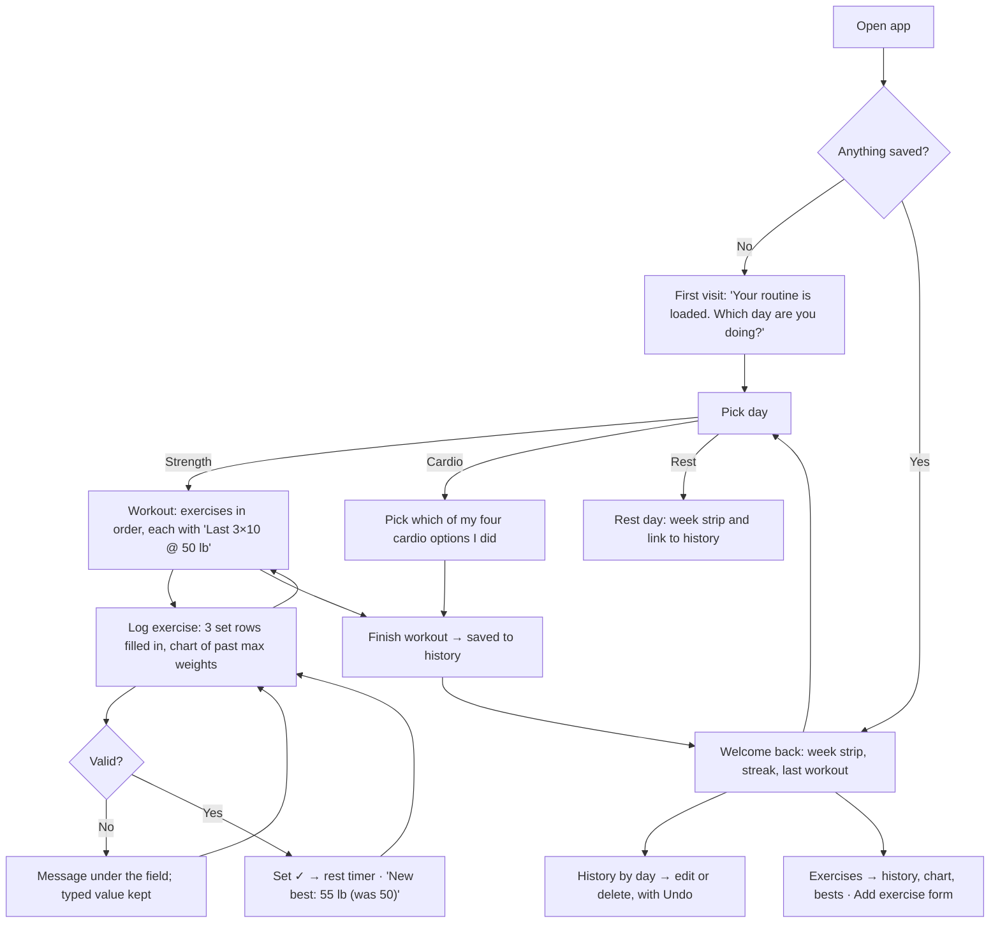

# Plate Log

A daily exercise log for my gym routine, built for Design, Build, Ship (MPCS 51238),
Assignment 3: Patterns & Flows. I log sets, reps and weight on my phone between sets; it shows
what I lifted last time, graphs my max weight for each exercise, keeps a history of past
workouts, and lets me add new exercises. It saves to the browser, so there's no account.

It reuses the **Plate Room** style and my workout routine from Assignment 2.

- Live site: _coming soon (Vercel)_
- Flows: [`flows.md`](flows.md)
- Onboarding research: [`docs/research/onboarding.md`](docs/research/onboarding.md)

## Flows

**Main task:** I pick today's day → I log each set as I finish it → I come back next week and it
shows what I lifted last time, set by set, and my chart is going up.



See [`flows.md`](flows.md) for what happens on each step and the list of pages.

## Onboarding research

Before designing the first visit, agents studied three browser-based trackers that need no
account — Liftosaur, Setly and TrackMySet — by using each one as a brand-new user. All three
drop you on an empty screen, and none of them shows a single form error. So Plate Log opens with
my routine already loaded and explains every error next to the field. Details and screenshots:
[`docs/research/onboarding.md`](docs/research/onboarding.md).

## First-run check

_To do after deploying: an agent will try the live site as a brand-new user, come back later,
and give usability feedback here._

## Running it

```bash
npm install
npm run dev     # http://localhost:3000
npm run build
npm run lint
```

Built with Next.js 16 and Tailwind CSS 4. Data lives in `localStorage` only — no database,
accounts or external APIs.
