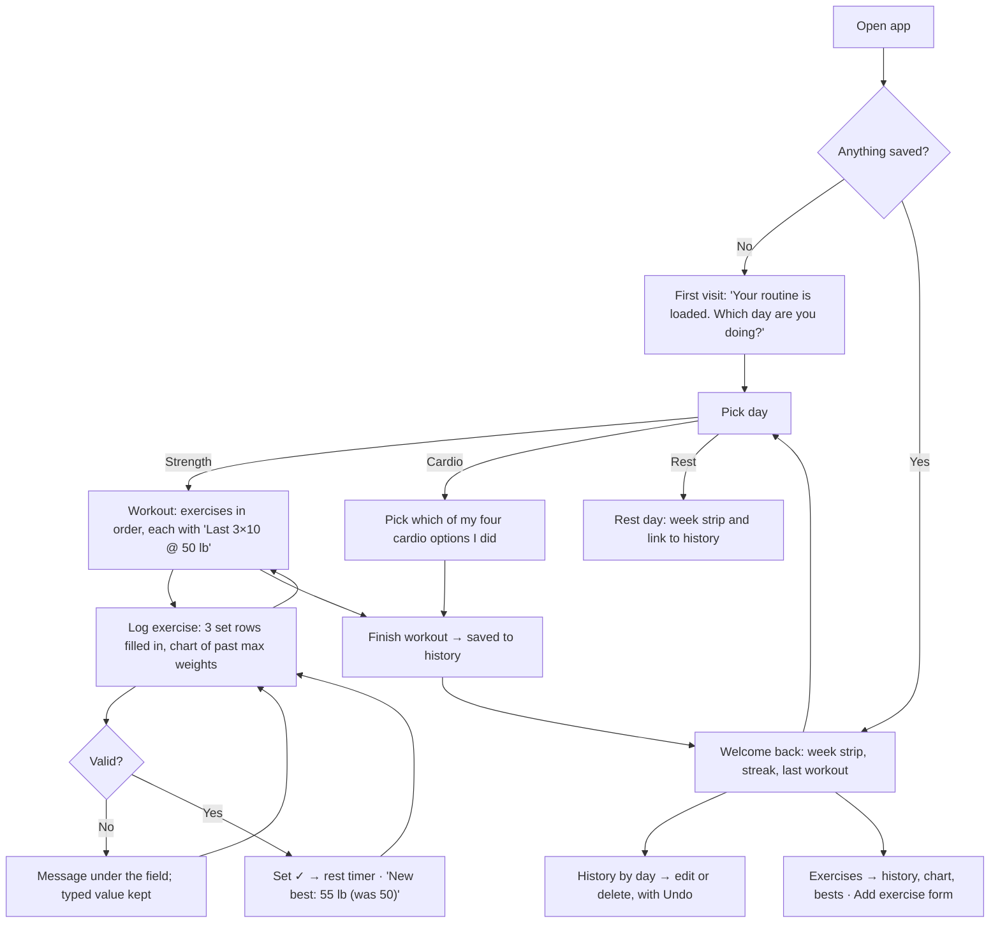

# Plate Log

A daily exercise log for my gym routine, built for Design, Build, Ship (MPCS 51238),
Assignment 3: Patterns & Flows. I log sets, reps and weight on my phone between sets; it shows
what I lifted last time, graphs my max weight for each exercise, keeps a history of past
workouts, and lets me add new exercises. It saves to the browser, so there's no account.

It reuses the **Plate Room** style and my workout routine from Assignment 2.

- Live site: _coming soon (Vercel)_
- Flows: [`flows.md`](flows.md)
- Onboarding research: [`docs/research/onboarding.md`](docs/research/onboarding.md)

## Flows

**Main task:** I pick today's day → I log each set as I finish it → I come back next week and it
shows what I lifted last time, set by set, and my chart is going up.



See [`flows.md`](flows.md) for what happens on each step and the list of pages.

## Onboarding research

Before designing the first visit, agents studied three browser-based trackers that need no
account — Liftosaur, Setly and TrackMySet — by using each one as a brand-new user. All three
drop you on an empty screen, and none of them shows a single form error. So Plate Log opens with
my routine already loaded and explains every error next to the field. Details and screenshots:
[`docs/research/onboarding.md`](docs/research/onboarding.md).

## Pages

Every step of the flows is its own page, and every page shares the bottom tab bar
(Today · History · Exercises). Inner pages add a back link and a title.

| Route | What it's for |
|---|---|
| `/` | Today: first visit or welcome back, week strip, streak, pick the day |
| `/workout/[day]` | The day's exercises with last time, cardio choice, or rest day |
| `/workout/[day]/[exercise]` | Log each set (prefilled from last time), rest timer, max-weight chart |
| `/history` | Month calendar and every past workout |
| `/history/[date]` | One day: fix a set, change cardio, delete a workout (with Undo) |
| `/exercises` | Every exercise and its best |
| `/exercises/new` | The add-exercise form |
| `/exercises/[id]` | One exercise's chart and sessions |

## Accessibility

- **Keyboard:** everything is a real button, link or input, and works with the keyboard.
  - A skip link comes first.
  - Every control shows a 3px focus ring.
  - Inside the set rows, Tab goes reps → weight → ✓.
- **Labels:** every field has a real label. The set table ties each input to its column header
  and set number ("Reps, Set 1").
- **Errors:** each error is tied to its field and announced, and it says what to do next.
- **Screen readers:** the week strip and calendar name every day. The chart has a text summary.
- **Tap targets:** every control is at least 44px, with no sideways scrolling at 390px wide.
  Checked page by page in Chrome.
- **Contrast** (WCAG, checked by `npm test` in `tests/theme.test.mjs`):

| Text on background | Ratio |
|---|---|
| Ink on concrete (page) | 15.3:1 |
| Muted on concrete | 6.3:1 |
| Ink on white panel | 18.7:1 |
| Muted on white panel | 7.7:1 |
| Ink on safety yellow (buttons, ticked sets) | 13.1:1 |
| White on blue (upper body) | 6.1:1 |
| White on red (legs) | 5.0:1 |
| White on green (cardio) | 5.4:1 |

Yellow is only ever a fill behind ink text, never text itself (1.4:1 on white).

## First-run check

_To do after deploying: an agent will try the live site as a brand-new user, come back later,
and give usability feedback here._

## Running it

```bash
npm install
npm run dev     # http://localhost:3000
npm test        # unit tests for the data, stats, validation and theme
npm run build
npm run lint
```

To review the coming-back screens without waiting a week, open `/dev/sample` (only available
in `next dev`, or when the server runs with `PLATE_LOG_SAMPLE=1`). It backs up your log, then
loads three weeks of sample workouts.

Built with Next.js 16 and Tailwind CSS 4. Data lives in `localStorage` only — no database,
accounts or external APIs.
