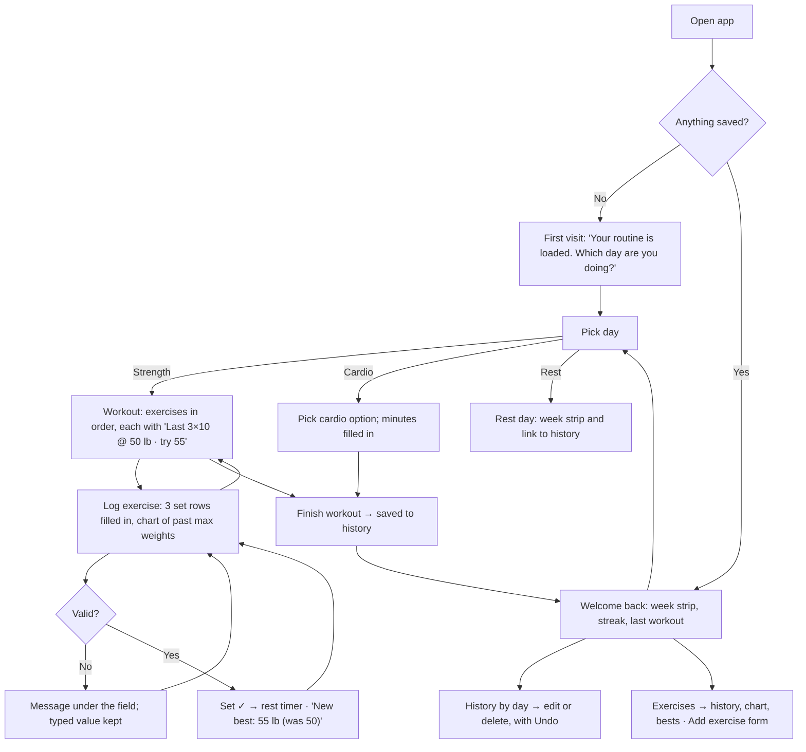

# Plate Log — user flows

Plate Log is a daily exercise log for my own gym routine. I use it on my phone, between sets.
It saves to the browser (localStorage), so it remembers me on this device with no account.

**Main task, as one sentence:**
I pick today's day → I log each set as I finish it → I come back next week and it shows what I
lifted last time, suggests what to try, and my chart is going up.

## All three flows

## 1. First visit — useful right away

- No sign-up, setup screens, tour or empty screen. My routine (back & biceps, shoulders &
  triceps, legs, cardio, rest) is already loaded.
- The first screen asks one thing: which day am I doing? About three taps later I've logged a set.

## 2. Main task — log each set between sets

- The workout lists that day's exercises in order, each showing last time and a suggestion.
- An exercise opens with three set rows filled in from last time. One tap ✓ per set, or change the
  number first. A rest timer starts after each ✓.
- Errors sit under the field and say what to do ("Enter the weight you lifted, in lb."), and
  what I typed stays put.
- Cardio days: pick one of my four options; the minutes are filled in and editable.
- Reopening the same day on the same date continues that workout.

## 3. Coming back — it remembers

- Welcome back with a week strip (trained days in blue for upper body, red for legs, green for
  cardio) and a weeks-in-a-row streak.
- Each exercise shows "Last 3×10 @ 50 lb" and suggests +5 lb when I hit every rep last time.
- A max-weight chart for each exercise, and a "New best" note when I beat a record.
- History by day, where I can edit or delete anything, with Undo.
- Exercises: weight history, chart and bests, plus a form to add new exercises.

## Pages

| Route | Step |
|---|---|
| `/` | Today: first visit or welcome back, week strip, streak, day picker |
| `/workout/[day]` | The picked day: exercise list, cardio picker or rest day |
| `/workout/[day]/[exercise]` | Log sets, rest timer, last time, suggestion, chart |
| `/history` | Past workouts by day |
| `/history/[date]` | One day: edit or delete, with Undo |
| `/exercises` | All exercises and bests |
| `/exercises/new` | Add an exercise (the form) |
| `/exercises/[id]` | One exercise: weight history, chart, best |

Every page shares a bottom tab bar (Today · History · Exercises); inner pages also have a back
link and a title.
